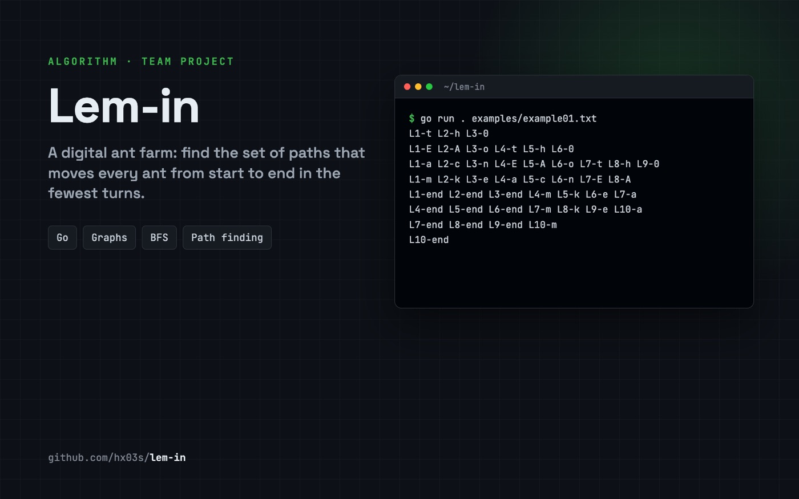

<div align="center">



# Lem-in 🐜

**A digital ant farm: find the paths that move every ant from start to end in the fewest turns.**

  

</div>

## The problem

The input describes a colony: a number of ants, rooms with coordinates, the tunnels between them, and which rooms are `##start` and `##end`.

```
4
##start
0 0 3
2 2 5
3 4 0
##end
1 8 3
0-2
2-3
3-1
```

All ants start in the start room. Each turn, every ant can move one tunnel, and **a room (other than start and end) can only hold one ant at a time**. The goal is to get every ant to the end in as few turns as possible.

## How it works

1. **Read and validate** the farm: ant count, rooms, links, start and end. Bad input (missing start or end, duplicate rooms, links to unknown rooms) is rejected with an error.
2. **Find paths** from start to end with breadth-first search.
3. **Choose the best set** of paths that don't share rooms, and decide how many ants to send down each. A longer path is only worth using when the queue on the shorter ones would take longer.
4. **Print every move**, one turn per line, as `L<ant>-<room>`.

## Usage

```bash
go run . examples/example01.txt
```

```
L1-t L2-h L3-0
L1-E L2-A L3-o L4-t L5-h L6-0
L1-a L2-c L3-n L4-E L5-A L6-o L7-t L8-h L9-0
...
L10-end
```

`examples/` has valid farms (`example00`–`example07`) and invalid ones (`badExample00`, `badExample01`).

## Project structure

```
main.go          entry point: read the file, solve, print
func/read.go     parse and validate the farm
func/path.go     path finding and path selection
func/ants.go     distribute ants and simulate the turns
func/structs.go  rooms, links and the farm
```

## Team

[hx03s](https://github.com/hx03s), [Saitamaxqi](https://github.com/Saitamaxqi), [Mena-Mh](https://github.com/Mena-Mh). Built at **[Reboot01](https://reboot01.com)**, Bahrain.

---

<div align="center">

Built by **Hasan Abdulla** · [github.com/hx03s](https://github.com/hx03s) · Bahrain 🇧🇭

</div>
